# The Glitch Arcade

Small Three.js games, one per genre, instrumented with [Glitchless](https://github.com/glitchless-gg/glitchless)
(game observability for players and coding agents). Each one tracks what its own genre cares about, ships with planted,
genre-typical problems for Glitchless to find, has an autoplay bot to fill its dashboard, and comes with the dashboard
its coding agent designed for it. None of them is a platformer: that's the point.

| Game | Genre | What it tracks | Planted problems | Port |
| --- | --- | --- | --- | --- |
| [**Blastpit!**](games/blastpit) | arena shooter (FPS) | shots, hits and kills by weapon, deaths by cause, rounds | an error in one weapon (the shotgun), a stutter when a swarm spawns | 5176 |
| [**Slipstream**](games/slipstream) | arcade racer | laps and lap times, wrecks by track section, finishing positions, boosts, overtakes, tracks | a boost pad into a hairpin, a skid-mark leak that slows every race | 5177 |
| [**Gatekeep**](games/gatekeep) | tower defense | towers built, upgraded and sold, gold spent, leaks and kills, waves | a wave that ends most runs, a health-bar texture per enemy that stutters in big waves | 5178 |
| [**Undervault**](games/undervault) | metroidvania (2.5D) | rooms visited and backtracking, relics found, saves, boss attempts | a room that kills most players, an error that only fires when you backtrack | 5179 |
| [**Gemfall**](games/gemfall) | match-3 puzzle | matches by size, shape and cascade depth, specials made and used, boosters, hints, stars and moves left per level | a level that's a wall, a cascade effect that leaks, a hint that throws at the board's edge | 5180 |
| [**Flapjack**](games/flapjack) | one-button flappy | runs and where they end, medals, biomes, new bests, retries | a squeeze at pipe 12, pipes that are never recycled | 5181 |
| [**Ashvale**](games/ashvale) | action RPG (top-down) | kills, loot and gear by rarity and slot, level-ups, skills, rooms cleared, boss attempts, floors | a legendary item that throws when you pick it up, an overtuned floor, damage numbers that pile up in the page | 5182 |

Every game's README lists its events, its planted problems (with file:line), its dashboard pages and what Glitchless
found when bots played it. Screenshots of each game and its dashboard are in [`assets/screenshots`](assets/screenshots).

| Game | Its dashboard |
| --- | --- |
| 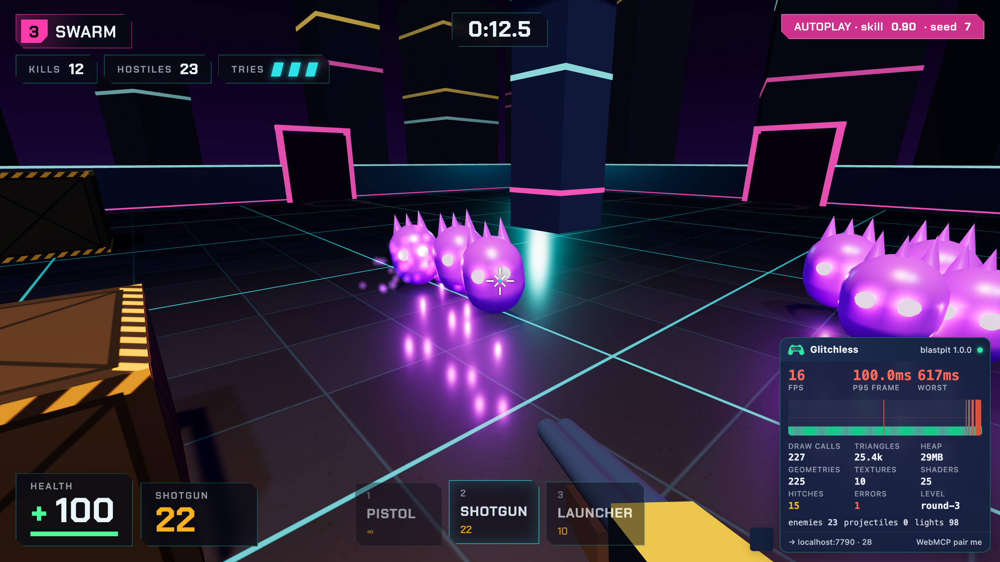 | 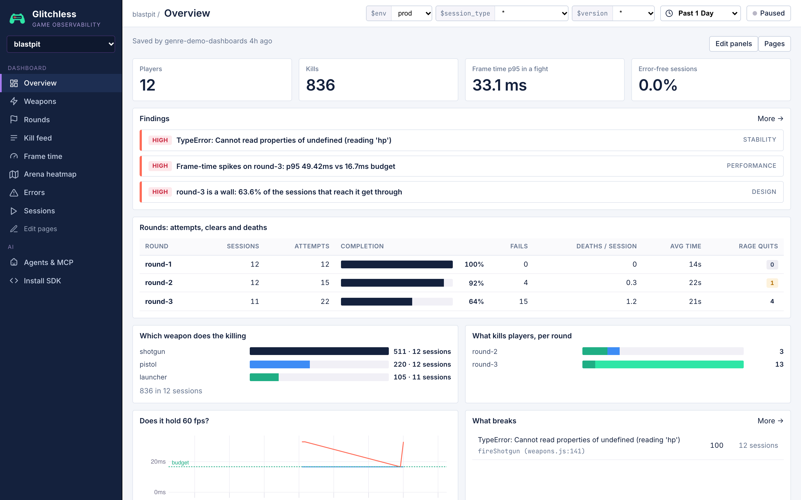 |
| 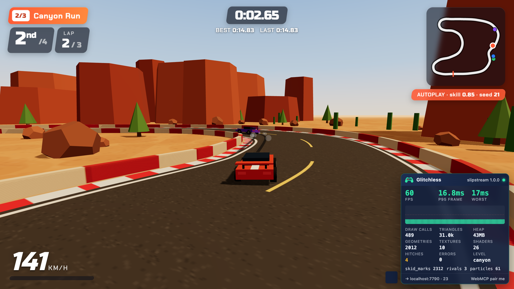 | 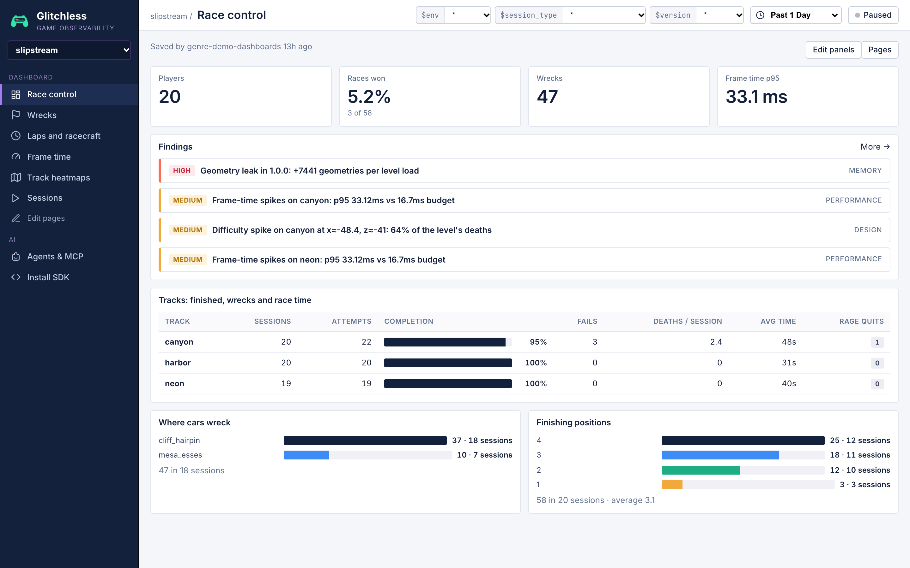 |
| 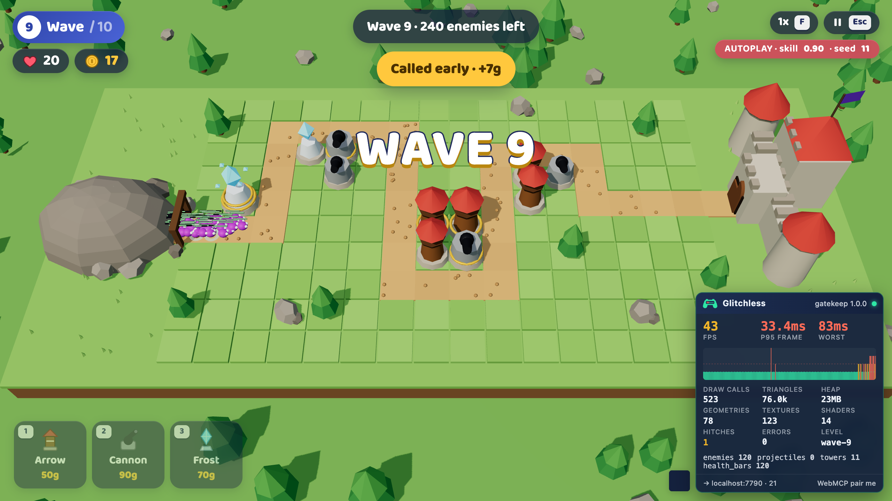 |  |
| 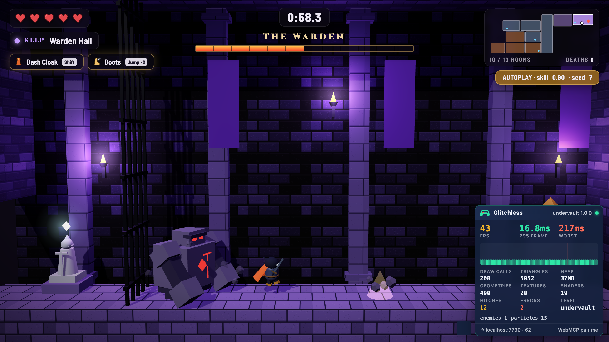 | 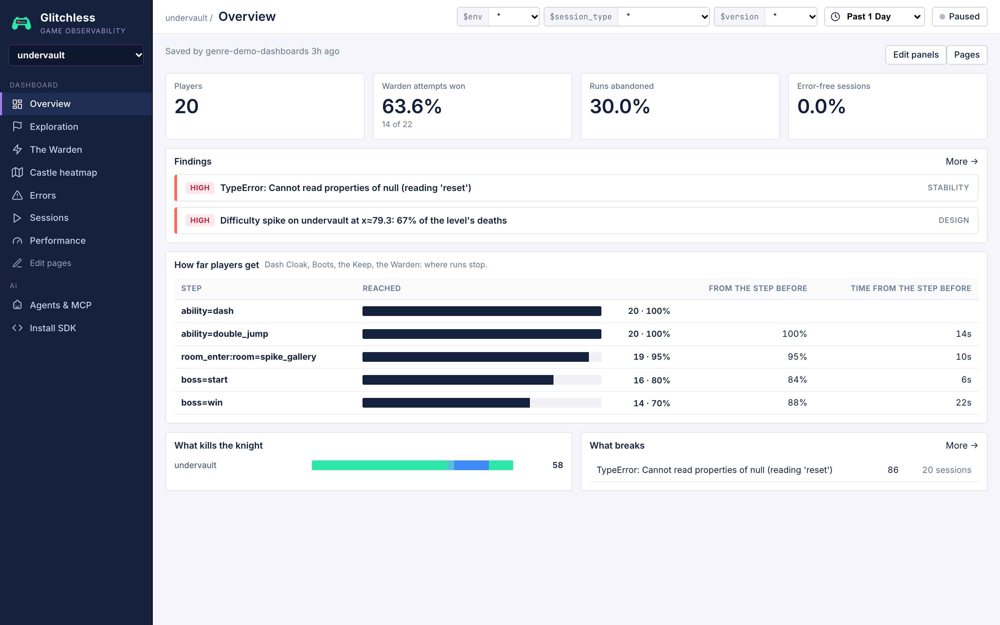 |
| 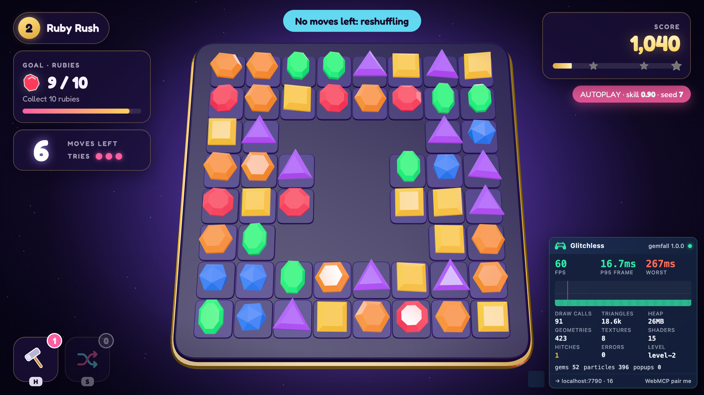 | 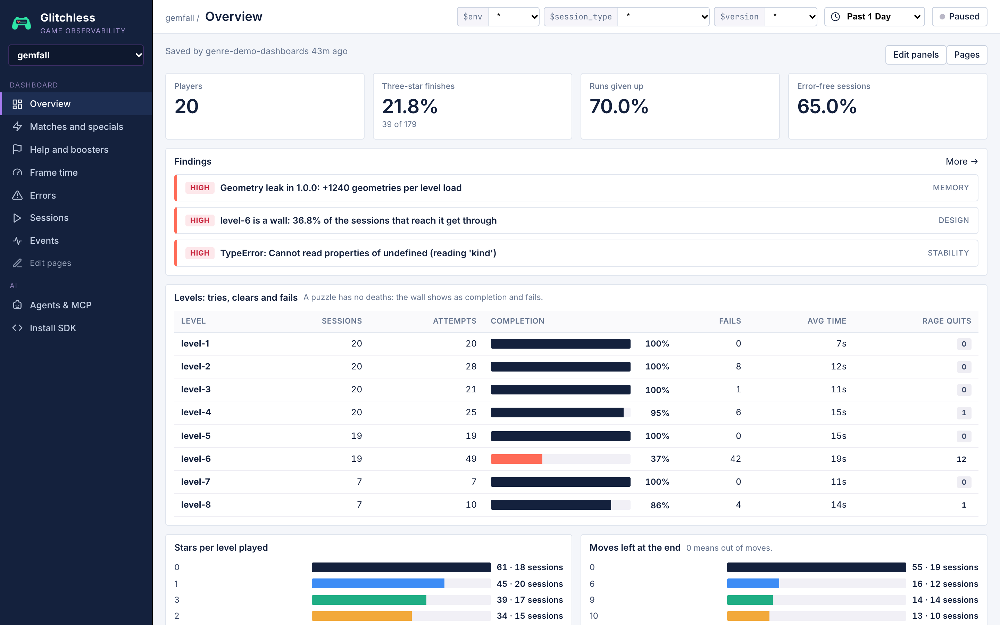 |
| 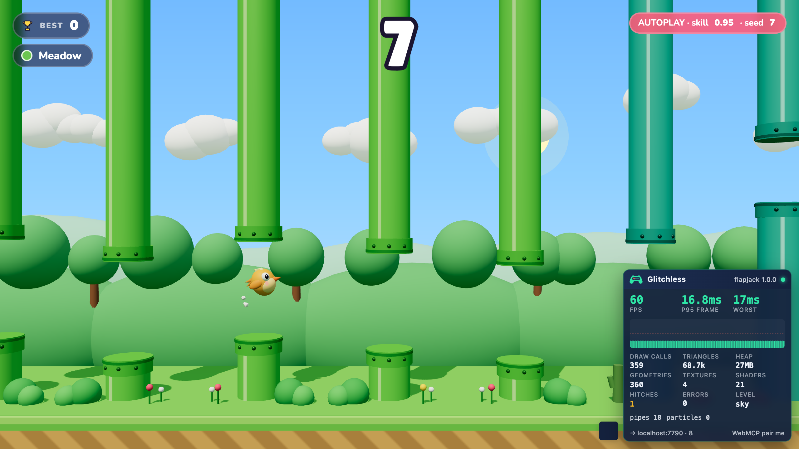 | 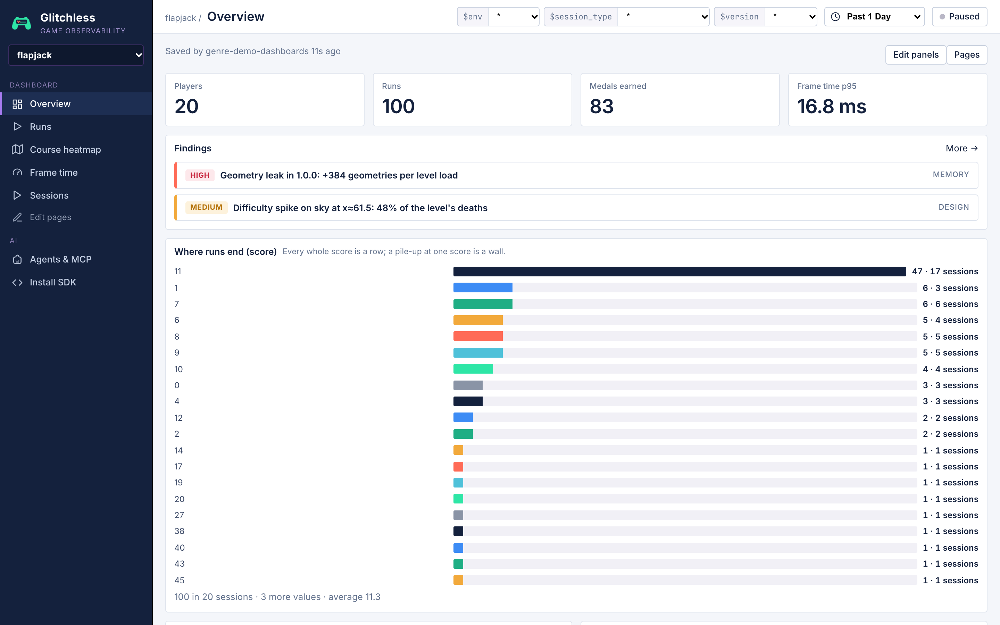 |
| 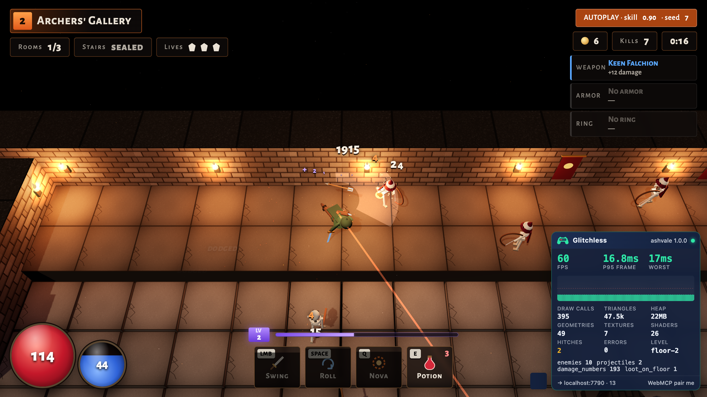 | 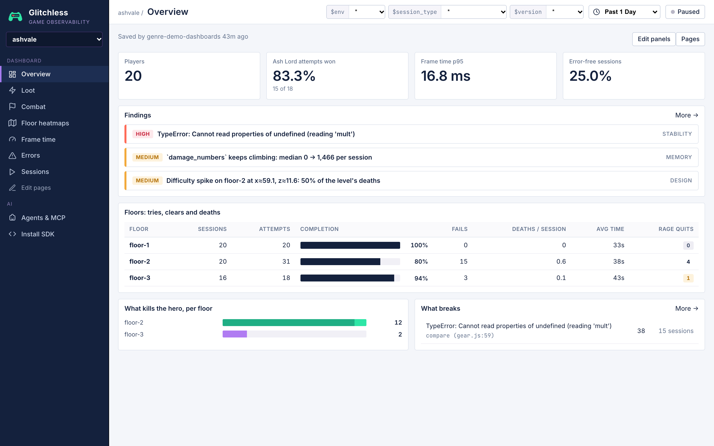 |

## Run a game

```bash
npm install
npm run blastpit          # or slipstream, gatekeep, undervault, gemfall, flapjack, ashvale; each prints its URL
```

The games send telemetry to a Glitchless server at `http://localhost:7777`. Run one from the Glitchless repo
(`npm run server`; the dashboard is on the same port), or send to Glitchless Cloud with
`?intake=https://api.glitchless.gg&token=gl_pub_…` and your project's client token. Without a server the games still run.
Press `` ` `` in any game for the Glitchless overlay.

The games use the published SDK (`glitchless` on npm): `src/telemetry.js` in each one is the whole integration, a small
facade that loads the SDK, calls `Glitchless.init()` and `instrumentThree()`, and keeps telemetry from ever breaking the
game. `src/agent-tools.js` gives coding agents game tools over WebMCP (jump to a level, trigger the planted problem,
read the game's state).

## Fill a dashboard with bots

Every game has an autoplay bot: `?autoplay=1&skill=0..1&seed=N` (its sessions are marked synthetic).

```bash
npm run gatekeep                                           # in one terminal
npm run bots -- --game http://localhost:5178/ --seed 5000  # 20 bots, skills 0.3 to 0.95
```

`--parallel` (default 2) is how many play at once; bots share your GPU, so keep it low (Blastpit wants 1). Each game also
has a `glitchless.playtest.json` for [`glitchless-playtest`](https://www.npmjs.com/package/glitchless-playtest), which
compares two builds.

## The dashboards

Each game's dashboard was designed by a coding agent with the Glitchless `dashboard` skill and saved with the
`glitchless_set_dashboard` MCP tool. The spec is in each game's folder as `glitchless.dashboard.json`; to put it on your
Glitchless server, ask your agent to save that file's pages for the game with `glitchless_set_dashboard` (the
[`glitchless-mcp`](https://www.npmjs.com/package/glitchless-mcp) server).

Nothing in them assumes a genre: the shooter's pages are weapons and rounds, the racer's are wrecks by track section and
laps, the tower defense game's are waves, towers and gold (no heatmap, no deaths: it has no avatar), the metroidvania's
are exploration, backtracking and the boss, the match-3's are stars, cascades and boosters (a puzzle has no world to
map), the flappy game's are where runs end and retries, and the action RPG's are floors, loot and combat.

## License

MIT
