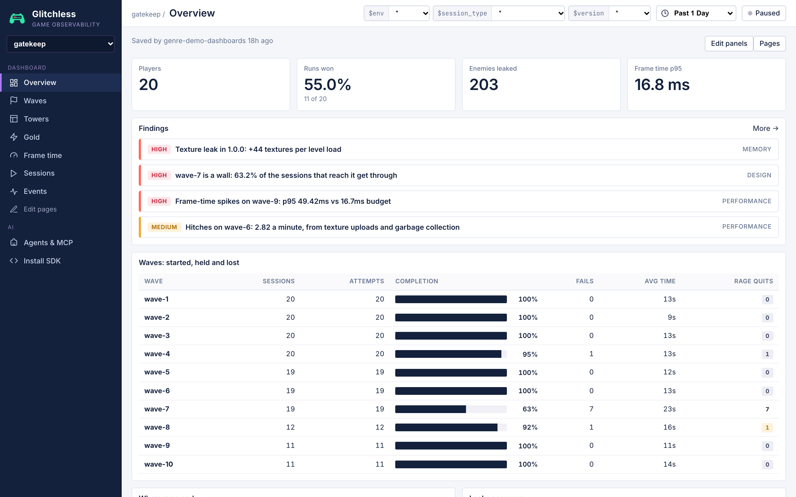

# Gatekeep

A small tower defense in vanilla Three.js, one of the Glitchless genre demos. Ten short waves walk a
winding dirt path from a cave to your castle gate; you spend gold on arrow, cannon and frost towers,
upgrade them, sell them, and call waves early for bonus gold. It looks like a "made this with AI over
a weekend" game, and it ships with **two deliberate, realistic problems** for Glitchless to find
(listed below). **Don't fix them**: the demo depends on them.

## Run it

From the root of this repo:

```bash
npm install
npm run dev -w gatekeep        # http://localhost:5178
npm run build -w gatekeep      # → games/gatekeep/dist (relative base './', deployable anywhere)
```

Telemetry goes to a Glitchless server at `http://localhost:7777` by default: run one from the
[Glitchless repo](https://github.com/glitchless-gg/glitchless) with `npm run server`. To send it to Glitchless Cloud
instead, add `?intake=https://api.glitchless.gg&token=gl_pub_…` with your project's client token. Without a server the
game still runs.

## Controls

| Input | Action |
| --- | --- |
| click a free tile | open the build menu (arrow 50g, cannon 90g, frost 70g); hover an option to see its range |
| hover a tile + `1` `2` `3` | build an arrow / cannon / frost tower there (with no free tile under the cursor it arms that tower; click to place) |
| click a tower card (bottom left) | arm that tower; click tiles to place, right-click or `Esc` to stop |
| click a tower | select it (range ring and stats); `U` upgrade (tier 2 and 3), `S` sell for 60% |
| `Space` / the top button | call the next wave early (+3 gold per second skipped) |
| `F` | toggle 2x speed |
| `Esc` / `P` | close menus, or pause |
| `M` | mute |
| `` ` `` | toggle the Glitchless overlay (bottom right) |

Towers: **arrow** (fast, single target), **cannon** (slow, splash), **frost** (slows everything in range,
little damage). Enemies: **runner** (fast), **grunt**, **brute** (armored: arrows do 25%; a leak costs 2
lives), **swarmling** (tiny, in huge numbers). The gate has 20 lives.

## Query params

| Param | Default | Meaning |
| --- | --- | --- |
| `autoplay=1` | off | the bot plays (see below) |
| `skill=0..1` | `0.7` | bot skill |
| `seed=N` | random | bot and spawn RNG seed (deterministic per seed) |
| `level=1..10` | `1` | start at wave N (with the gold you would have earned: +110 per wave skipped) |
| `token=` | `gl_pub_dev` | Glitchless client token (public, write-only); `VITE_GLITCHLESS_TOKEN` at build time |
| `env=`, `intake=`, `dashboard=`, `nogd=1`, `mute=1` | | as in [Zoomies](https://github.com/glitchless-gg/glitchless/tree/main/apps/zoomies) |

Example: `http://localhost:5178/?autoplay=1&skill=0.3&seed=42`

### The bot (`src/autoplay.js`)

The bot spends gold before and during each wave from a build plan: every buildable tile ranked by how
much of the path each tower type reaches from it. Low skill picks arrows about 80% of the time, lands
further down the list, reacts slowly, rarely upgrades and never adapts, so the wave 7 brutes usually
break it. High skill puts frost at a chokepoint and cannons on the bends, upgrades, switches to cannons
(and sells a couple of arrows) the moment it sees a brute, calls waves early and toggles 2x now and
then. Every skill sells its least useful tower now and then. When the run ends it shows a "halted" card,
sets `window.gatekeep.halted` and `window.__GLITCHLESS_PLAYTEST_DONE__`, and ends the session a second
later. The sim and bot are pure, so `node` can run them headless for balancing.

| skill | wins (of 30) | where the rest end | real time (avg) |
| --- | --- | --- | --- |
| 0.3 | 2 | 27 at wave 7, 1 at wave 4 | ~125 s |
| 0.45 | 3 | 26 at wave 7, 1 at wave 8 | ~130 s |
| 0.6 | 14 | 15 at wave 7, 1 at wave 8 | ~115 s |
| 0.7 | 20 | 10 at wave 7 | ~120 s |
| 0.8 | 25 | 3 at wave 7, 2 at wave 8 | ~130 s |
| 0.95 | 30 | | ~120 s |

(From the headless sim, `node` running `src/sim.js` and `src/autoplay.js`. Real browser sessions run a few
seconds longer.)

## Events

| Event | Attributes | When |
| --- | --- | --- |
| `tower_built` | `type` (`arrow`/`cannon`/`frost`), `zone` (`entry`/`middle`/`gate`: the stretch of path it covers) | a tower is built |
| `tower_upgraded` | `type`, `tier` (2 or 3) | a tower is upgraded |
| `tower_sold` | `type` | a tower is sold |
| `gold_spent` | `on` (`build`/`upgrade`), `type`, `gold` (integer) | with every build and upgrade |
| `leak` | `enemy` (`runner`/`grunt`/`brute`/`swarmling`) | an enemy reaches the gate (`$level` is the wave) |
| `kill` | `tower` (the tower type that landed the blow), `enemy` | an enemy dies |
| `early_call` | none | a wave is called early (sent after its `levelStart`, so `$level` is the wave called) |
| `fast_forward` | `on` (boolean) | 2x speed toggled |
| `run_end` | `result` (`win`/`lose`), `wave` (the wave reached) | the run ends |

Every frame: `setContext({ enemies, projectiles, towers, health_bars })`. There is no player avatar and
no deaths, so no `death`, `setPosition` or `captureMap`.

## Levels

Each wave is a level, `wave-1` … `wave-10`: `levelStart` when it starts, `levelComplete({ durationS, score: gold })`
when every enemy in it is dead or leaked and the gate stands (`durationS` is game time), `levelFail({ cause })`
when the gate falls (`cause` is the enemy type whose leak broke it), which ends the run.

| Wave | Enemies |
| --- | --- |
| 1–6 | grunts and runners, a few more each wave |
| 7 | 12 brutes |
| 8 | grunts, 3 brutes, runners |
| 9 | the swarm: 120 swarmlings out of the cave within about a second, then 120 more four seconds later |
| 10 | grunts, 5 brutes, runners |

## Agent tools (WebMCP, `src/agent-tools.js`)

| Tool | Input | Does |
| --- | --- | --- |
| `gatekeep_get_state` | none | phase, wave, gold, lives, speed, towers (type, tier, tile, zone, kills), enemies by type, projectiles, live and created health bars, renderer draw calls / geometries / textures |
| `gatekeep_start_wave` | `{ wave: 1..10 }` | clear the field and start that wave now (a normal `levelStart`) |
| `gatekeep_build` | `{ type, col, row }` | build a tower through the same path as a click |
| `gatekeep_add_gold` | `{ amount }` | add gold |
| `gatekeep_spawn_swarm` | `{ count }` | spawn swarmlings out of the cave through the real spawn path (one health-bar texture each) |

The same handlers are on `window.gatekeep.api`; `window.gatekeep.info` prints renderer and health-bar counts.

## The planted problems

Each is marked `// GLITCHLESS-DEMO:` in the code.

| # | Problem | Where | What happens | What Glitchless should show |
| --- | --- | --- | --- | --- |
| 1 | **Wave 7 armor spike** | `src/rules.js:52-56` (brutes take 25% from arrows), `src/rules.js:80-82` (wave 7) | Six waves of grunts and runners reward cheap arrow towers. Wave 7 is 12 armored brutes, unannounced; arrows barely scratch them and each leak costs 2 lives. Arrow-heavy defenses leak most of the wave and the run ends there. | `wave-7` with by far the worst completion in the levels table; `leak` by `$level` spiking on `wave-7` (mostly `enemy: brute`); `run_end` `wave` piling up at 7; `levelFail` cause `brute`; a design finding, *wave-7 is a wall* |
| 2 | **A health-bar texture per enemy** | `src/healthbars.js:24-44` (`createHealthBar`), `:46-76` (`redraw`: on every hit, and on every frame while a new bar fills up or a damage chunk drains, `:85-92`), `:94-101` (`removeHealthBar`, never disposes); called from `src/main.js:87`, `:104`, `:163`, `:482`; the swarm is `src/rules.js:88-98` | Each enemy gets its own 128x16 canvas, `CanvasTexture` and `SpriteMaterial`. The bar is redrawn (with a soft `shadowBlur` under the frame) and re-uploaded on every hit and on every frame while it fills up from empty or drains a damage chunk. Wave 9 pours 120 swarmlings out of the cave within about a second, twice, four seconds apart: 100–240 canvas redraws and texture uploads land in single frames. Dead and leaked enemies' textures are never disposed. Measured on this M3 Max (Chrome 156, headless, 1280x720): wave 9 runs at p95 50–67 ms with 19–36 frames over 50 ms per run, while waves 8 and 10 stay at 16.7 ms; with one shared texture the same runs stay at 16.8 ms. | hitches and a frame-time p95 jump on `wave-9`, with `health_bars` and `enemies` near 200 in those windows; the renderer's `textures` (Glitchless overlay, `gatekeep_get_state`) climbing all run (+1 per enemy, ~400 after a full run) and never coming down: a *Texture leak* finding |

## Dashboard

Designed with the `dashboard` skill and saved with `glitchless_set_dashboard`; the spec is
[`glitchless.dashboard.json`](glitchless.dashboard.json) (send it to the tool to recreate it). A tower defense game has
no avatar and no deaths, so there are no heatmaps and no deaths panels: its pages are about waves, towers and gold.

| Page | What it answers |
| --- | --- |
| **Overview** | players, runs won, enemies leaked, frame time p95; the findings; *Waves: started, held and lost* (the levels table, one row per wave); where runs end; leaks per wave |
| **Waves** | leaks, early calls, hitches per minute, average session; which wave is the wall; what gets through; leaks per wave; does it stutter in big waves (frame time); enemies killed |
| **Towers** | built, upgraded, sold, kills; what players build; which towers do the killing; where they build; how far they upgrade; what they sell; builds over time |
| **Gold** | purchases, the share that are upgrades, early calls, switches to 2x; spending by tower; building vs upgrading; price paid per purchase (with the average); purchases per wave |
| **Frame time**, **Sessions**, **Events** | built-in views |

What Glitchless found in the 20 bot sessions (`npm run bots -- --game http://localhost:5178/ --seed 5000`):

- **high, memory:** *Texture leak in 1.0.0: +44 textures per level load*: the renderer's texture count goes from 3 to
  about 400 a session (medians) and "never comes back down": one health-bar `CanvasTexture` per enemy, never disposed.
  The advice: dispose textures you stop using, and share one texture instead of making one per object.
- **high, design:** *wave-7 is a wall: 63.2% of the sessions that reach it get through*: 12 of 19, with every other wave
  at 92–100%. A tower defense game has no deaths, so this finding comes from completion rather than from where players
  die: 7 fails end the attempts, 135 of the 203 leaks are on wave 7, and 7 of the 9 lost runs end there (`run_end` by
  `wave`).
- **high, performance:** *Frame-time spikes on wave-9: p95 49.42ms vs 16.7ms budget*: 18.8% of wave 9's frames over budget,
  20 hitches a minute, every other wave at 16.78 ms. The hitches' top cause is `texture_upload` (48), and the advice
  says "a CanvasTexture per object, or needsUpdate on every change: share one texture or atlas".
- **medium, performance:** *Hitches on wave-6: 2.82 a minute, from texture uploads and garbage collection*: wave 6's p95
  holds at 16.78 ms, but 10 frames stalled across 19 sessions (`texture_upload` 7, `gc` 5): the health-bar textures
  again, three waves before the swarm turns them into a frame-time spike.
- Arrows are the most-built tower (112) but cannons do the killing (3,653 of 4,994 kills): the adaptation the wave
  teaches.


