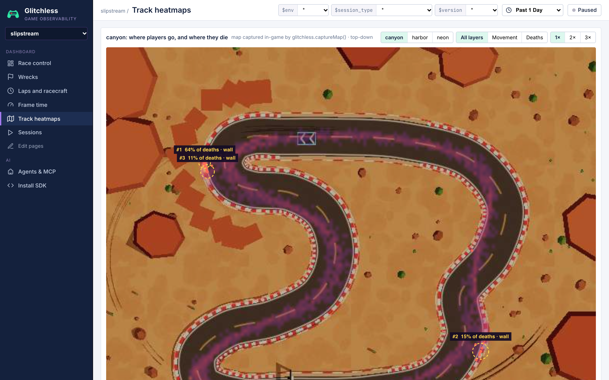

# Slipstream

A small arcade racer in vanilla Three.js, and one of the Glitchless genre demos. You drive a low-poly
car with a chase camera against three AI rivals (NOVA, VERDE and MAKO) over three tracks of three
laps each: Harbor Loop, Canyon Run and Neon Ring. Points per race (10/6/4/2) add up to a
championship. Like Zoomies, it is meant to look like a game someone made with AI over a weekend, and
it ships with **two deliberate, genre-typical problems** for Glitchless to find (listed below).
**Don't fix them**: the demo depends on them.

## Run it

From the root of this repo:

```bash
npm install
npm run dev -w slipstream        # http://localhost:5177
npm run build -w slipstream      # → games/slipstream/dist (relative base './', deployable anywhere)
```

Telemetry goes to a Glitchless server at `http://localhost:7777` by default: run one from the
[Glitchless repo](https://github.com/glitchless-gg/glitchless) with `npm run server`. To send it to Glitchless Cloud
instead, add `?intake=https://api.glitchless.gg&token=gl_pub_…` with your project's client token. Without a server the
game still runs.

## Controls

| Key | Action |
| --- | --- |
| `W` / `↑` | throttle |
| `S` / `↓` | brake, then reverse |
| `A` `D` / `←` `→` | steer |
| `Space` | handbrake (drift); confirms on menus |
| `R` | put the car back on the road (reported as `reset`) |
| `Esc` / `P` | pause; then `R` restarts the race (`levelFail{cause:'restart'}`), `Q` quits to the title (`levelFail{cause:'quit'}`) |
| `M` | mute |
| `` ` `` | toggle the Glitchless overlay (bottom-right) |

Hitting a barrier bounces the car and costs speed. A **hard hit** (impact over 70% of top speed at
more than 25°) or a hard side hit from a rival (closing speed over 13 m/s) is a **wreck**: the car
tumbles and respawns on the centerline at the start of the section it was in after 1.5 s.
Boost pads (glowing chevrons) give +40% speed for 1.2 s.

## Query params

| Param | Default | Meaning |
| --- | --- | --- |
| `level=1..3` | `1` | start at a track (harbor, canyon, neon) |
| `autoplay=1` | off | the bot drives (see below) |
| `skill=0..1` | `0.7` | bot skill |
| `seed=N` | random | bot and rival RNG seed (deterministic per seed) |
| `env=` | `dev` | Glitchless env |
| `token=` | `gl_pub_dev` | Glitchless client token (public, write-only); `VITE_GLITCHLESS_TOKEN` at build time |
| `intake=` / `dashboard=` | `http://localhost:7777` | Glitchless API base URL / dashboard URL |
| `nogd=1` | off | skip Glitchless completely |
| `mute=1` | off (autoplay is always muted) | no sound |

### Autoplay bot (`src/autoplay.js`)

The bot drives the player car with the same driver as the rivals (`src/driver.js`, rivals have fixed
skills 0.9, 0.75 and 0.6): pure pursuit on a minimum-curvature racing line, with a lookahead that
grows with speed, and a target speed from the curvature coming up. Skill scales the mistakes: late
braking, a lag in noticing sudden speed (a boost), optimistic corner speeds, overshooting, a wobbly
line and clumsy handbrake flicks into tight corners. Only drivers above ~0.65 sometimes remember that
the canyon's last boost pad has to be hit slowly. The bot presses `R` when it's stuck or (nervous
drivers) after a hard knock, restarts a race after its second wreck (more often the lower the skill, once per track) and
rage quits (`levelFail{cause:'quit'}`) after three wrecks in one race when skill < 0.5. It races
harbor → canyon → neon, then shows a "halted" card, sets `window.slipstream.halted` and
`window.__GLITCHLESS_PLAYTEST_DONE__`, and ends the session.

Measured on an M3 Max (18 batch sessions with skills 0.3–0.95, plus sequential runs):

| skill | typical run | wrecks per run (mostly `cliff_hairpin`) | finishing positions |
| --- | --- | --- | --- |
| 0.3–0.4 | rage quits on canyon after ~90–120 s, or finishes in ~190 s after a restart | 4–6 | 4th |
| 0.45–0.65 | finishes, ~135–140 s | 2–4 | 3rd–4th, sometimes 2nd |
| 0.7–0.8 | finishes, ~130 s | 0–3 | 2nd–4th |
| 0.85–0.95 | finishes, ~125 s | 0 | 1st–3rd |

`R` presses show up in roughly a third of the sessions below 0.75, restarts below ~0.6 and rage quits below 0.5.

## Events

| Event | Attributes | When |
| --- | --- | --- |
| `levelStart` | track id | a race starts (countdown), including restarts |
| `levelComplete` | `durationS` (race time), `score` (points 10/6/4/2) | the player crosses the line on the last lap, in any position |
| `levelFail` | `cause`: `restart` \| `quit` | the player restarts the race or quits it |
| `death` | `x`, `y` (0), `z`, `cause`: `wall` \| `rival` | the player wrecks |
| `wreck` | `section`, `cause`: `wall` \| `rival` | the player wrecks |
| `lap` | `lap` (1–3), `time_s` (whole seconds) | the player completes a lap |
| `race_finish` | `position` (1–4) | the player crosses the line on the last lap |
| `boost` | `section` | the player drives over a boost pad |
| `overtake` | `section` | the player's race position improves (and holds for 0.5 s) |
| `reset` | `section` | the player presses `R` |

Nothing is reported for the cool-down lap the AI drives for you after the finish line.
Every frame: `setPosition(player car)` and `setContext({ skid_marks, rivals, particles })`.
`captureMap(track, { axis: 'xz', bounds })` runs once per track per session, right after the track is
built, with the cars, sky and tunnel roof hidden.

## Levels (tracks)

Each track is a closed loop (a centripetal Catmull-Rom curve, `src/tracks.js`, geometry in
`src/track-geom.js`), raced for 3 laps. Sections are low-cardinality `section` values and also the
respawn checkpoints.

| Track | Length | Sections (length) | captureMap bounds (xz) | Boost pads |
| --- | --- | --- | --- | --- |
| `harbor` Harbor Loop (easy) | 471 m | `start_straight` 123 m, `harbor_bend` 104, `pier_run` 111, `lighthouse_turn` 70, `warehouse_sweep` 63 | `[-120,-91]` → `[127,82]` | start straight, pier run |
| `canyon` Canyon Run (medium) | 433 m | `start_straight` 76 m, `mesa_esses` 97, `long_descent` 74, `cliff_hairpin` 59, `tunnel` 48, `finish_sweep` 79 | `[-86,-85]` → `[101,83]` | start straight, **end of long_descent** |
| `neon` Neon Ring (hard) | 454 m | `start_straight` 95 m, `pixel_chicane` 65, `tower_sweep` 57, `double_chicane` 165, `skyline_bend` 72 | `[-104,-90]` → `[115,89]` | start straight |

## Agent tools (WebMCP, `src/agent-tools.js`)

| Tool | Input | Does |
| --- | --- | --- |
| `slipstream_get_state` | none | track and sections, lap, position, race/best lap time, player position, speed, section and wrecks, rivals, live skid-mark count, particles, renderer draw calls and geometries, UI state |
| `slipstream_load_track` | `{ track: 'harbor'\|'canyon'\|'neon' }` | load a track and start a race on it |
| `slipstream_teleport` | `{ section }` | put the car, stopped, at the start of a section of the current track |
| `slipstream_spawn_skids` | `{ count }` | lay `count` skid marks behind the car through the real `addSkidMark()` path |
| `slipstream_set_paused` | `{ paused }` | pause or resume |

The same handlers are on `window.slipstream.api`; `window.slipstream.info` prints renderer numbers.

## The planted problems

Each one is marked in the code with `// GLITCHLESS-DEMO: <name>`.

| # | Problem | Where | What happens | What Glitchless should show |
| --- | --- | --- | --- | --- |
| 1 | **Boost pad into the Cliff Hairpin** (design difficulty spike) | `src/tracks.js:90-93` (the second canyon pad, 9 m before `cliff_hairpin`; the hairpin is control points 10–15 of the canyon) | The pad sits on the racing line at the end of `long_descent`. It kicks a car doing ~180 km/h up to ~250 km/h about 20 m before the turn-in of a tight 180° hairpin; braking from there can't get the car down to the hairpin's speed, so it slides into the outer barrier at well over 70% of top speed: a wreck. Only a driver who brakes *before* the pad gets through. Low and mid-skill drivers (and the rivals) wreck there on most laps. | `wreck` by `section` dominated by `cliff_hairpin`; the canyon death heatmap clustered at the hairpin; the longest average race time (`levelComplete.durationS`) and most restarts/quits on `canyon` |
| 2 | **Skid-mark leak** (leak on restart, frame time that degrades) | `src/skids.js:13-31` (`addSkidMark`), called from `skids.step()` at `src/skids.js:59` for every car; `unloadTrack()` at `src/world.js:541`, called at `src/main.js:135` | Every 0.6 m of hard braking, drifting or sliding, each rear wheel of every car (rivals too) gets a new `Mesh` with its own `PlaneGeometry` and `MeshBasicMaterial`, added to the scene root rather than the track group. Marks fade to opacity 0 after 14 s but are never removed or disposed, and `unloadTrack()` (restart, next race) only frees the track group. A run ends with ~15–19k marks; draw calls climb from ~160 to several thousand and render CPU with them. | `geometries` and draw calls rising across the session, `skid_marks` in ctx high in the slow windows, frame time p95 and slow-frame share worst on `neon` (the third track), faster with restarts |

What the scratch Glitchless server showed for these (bot sessions):

- **Problem 1:** 73% of `wreck` events had `section: cliff_hairpin` (the rest `mesa_esses`); the canyon
  heatmap's top hotspot holds 72–85% of the level's deaths, right at the hairpin (x≈-48, z≈-41), and
  the "Difficulty spike on canyon" finding fires. Average race time: harbor 31 s, canyon 47 s, neon
  40 s; canyon is the only track with restarts, quits and rage quits (completion 72–83%).
- **Problem 2:** the "Geometry leak" finding (+4,800 to +7,200 geometries per level load, 47 → ~15k by
  the end of a run); `skid_marks` in ctx ~1.6k on harbor, ~6.5k on canyon, ~13k on neon; draw calls
  average ~580 → ~2,000 → ~3,400 (max ~7,800). On a quiet M3 Max the slow-frame share was 0.1% on
  harbor, 0.6% on canyon and 12% on neon (p95 16.8 → 33 ms); render CPU per frame is ~0.7 ms with no
  marks, ~5.5 ms at 4k marks and ~17.5 ms at 12k. `slipstream_spawn_skids({ count: 8000 })` reproduces
  it in seconds.

## Files

```
index.html            HUD, minimap and screens (the bottom-right corner is left for the Glitchless overlay)
src/main.js           renderer, game state machine, fixed-step loop, telemetry, agent API, boot
src/tracks.js         track data (plain data): control points, sections, boost pads
src/track-geom.js     track math: samples, normals, curvature, racing line, sections
src/physics.js        arcade car physics, barriers, boost pads, car contact (pure, no THREE)
src/race.js           one race: grid, laps, wrecks/respawns, positions, results (pure)
src/driver.js         the AI driver (rivals and the bot)
src/autoplay.js       the bot
src/world.js          builds/unloads a track's meshes, sky and lights
src/car.js            the car model and its animation
src/skids.js          skid marks (problem 2)
src/fx.js             pooled sparks and smoke
src/camera.js, hud.js, input.js, audio.js, textures.js, theme.js, rng.js, params.js, version.js
src/telemetry.js      Glitchless facade + init; src/glitchless-sdk.js holds the SDK imports
src/agent-tools.js    WebMCP tools
```

## Dashboard

Designed with the `dashboard` skill and saved with `glitchless_set_dashboard`; the spec is
[`glitchless.dashboard.json`](glitchless.dashboard.json) (send it to the tool to recreate it). Wrecks are this game's
deaths (the car respawns at the last checkpoint), so the deaths panels and the heatmap show where cars wreck.

| Page | What it answers |
| --- | --- |
| **Race control** | players, races won, wrecks, frame time p95; the findings; *Tracks: finished, wrecks and race time* (the levels table); where cars wreck; finishing positions |
| **Wrecks** | wrecks, the share in the Cliff Hairpin, car resets, races abandoned; wrecks by track section and by track; *boost at the bottom of the descent, then a wreck in the hairpin* (a funnel); walls or rivals; where players reset the car |
| **Laps and racecraft** | laps, overtakes, boost pads hit, average session; lap times (whole seconds, with the average); finishing positions; where players overtake; boost pads used; positions over time |
| **Frame time**, **Track heatmaps**, **Sessions** | built-in views (the heatmaps are top-down maps of each track, captured in-game) |

What Glitchless found in the 20 bot sessions (`npm run bots -- --game http://localhost:5177/ --seed 5000`):

- **high, memory:** *Geometry leak in 1.0.0: +7441 geometries per level load*: from 47 to about 15,000 per session,
  "never comes back down". The skid marks: the finding also names the `skid_marks` gauge, which keeps climbing with it
  (0 to 15,186 in 20 of 20 sessions).
- **medium, performance:** *Frame-time spikes on canyon* (p95 33 ms, 6.4% of frames over budget) and *on neon*
  (21.6% over budget), each with "`skid_marks` sits at 7,124 / 12,686 for this whole level vs 2,104 on harbor: objects
  created earlier are never cleaned up". Draw calls average 691 on harbor, 2,250 on canyon, 3,200 on neon. The hitches'
  causes name the uploads: `geometry_upload` 57, `shader_compile` 80, `render` 133.
- **medium, design:** *Difficulty spike on canyon at x≈-48.4, z≈-41: 64% of the level's deaths*, all `wall`: 30 of 47
  in x -48.6 to -47.6, z -43.9 to -38.2, the Cliff Hairpin, right after the boost pad. 37 of the 47 wrecks are in
  `cliff_hairpin`, and 18 of the 20 sessions that hit the pad at the bottom of the descent wrecked in the hairpin after
  it.
- Rivals wreck there too, so the hairpin is also where players overtake most (44 of 102).


