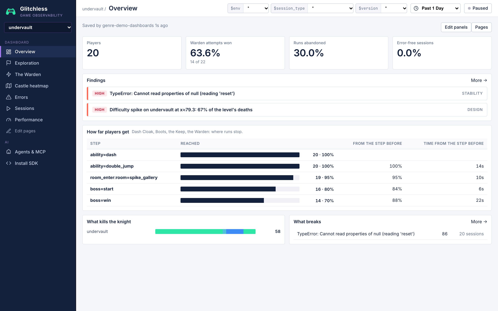

# Undervault

A small 2.5D metroidvania in vanilla Three.js, and one of the Glitchless genre demos. A hooded knight
explores a ten-room castle in three areas (the blue-grey Catacombs, the orange Foundry and the purple
Keep). On the way it finds the Dash Cloak and the Winged Boots, backtracks through rooms it has already
cleared, and fights the Warden, a stone golem. A good run takes about a minute and a half. The game has
**two deliberate problems** for Glitchless to find (listed below). **Don't fix them**: the demo depends
on them.

## Run it

From the root of this repo:

```bash
npm install
npm run dev -w undervault        # http://localhost:5179
npm run build -w undervault      # → games/undervault/dist (relative base './', deployable anywhere)
```

Telemetry goes to a Glitchless server at `http://localhost:7777` by default: run one from the
[Glitchless repo](https://github.com/glitchless-gg/glitchless) with `npm run server`. To send it to Glitchless Cloud
instead, add `?intake=https://api.glitchless.gg&token=gl_pub_…` with your project's client token. Without a server the
game still runs.

## Controls

| Key | Action |
| --- | --- |
| `←` `→` / `A` `D` | move |
| `Space` / `W` / `↑` | jump (hold for a higher jump; coyote time and a jump buffer). Press again in mid-air once you have the Boots |
| `J` / `X` | sword (one hit kills a bat or a crawler; the Warden takes 12) |
| `Shift` / `K` | dash, on the ground or in the air, once you have the Dash Cloak |
| `Esc` / `P` | pause. In the pause menu, `R` restarts the run and `Q` quits to the title |
| `M` | mute |
| `` ` `` | toggle the Glitchless overlay (bottom-right) |

You have 5 hearts. Bats and crawlers take 1 heart per hit. The Warden's slam, shockwave and charge take
3, and touching it while it isn't recovering takes 1. Spikes and lava kill outright. Touching a save
statue (in the Gate, the Furnace, the Boot Shrine and Warden Hall) sets your respawn point and refills
your hearts. When you die, the screen fades out and you wake up at the last statue you touched.

## Query params

| Param | Default | Meaning |
| --- | --- | --- |
| `autoplay=1` | off | the bot plays (see below) |
| `skill=0..1` | `0.7` | bot skill: timing noise, reaction time, missed enemies, panic jumps and greed at the boss all scale with `1 - skill` |
| `seed=N` | random | bot RNG seed (each seed replays the same run) |
| `env=` | `dev` | Glitchless env |
| `token=` | `gl_pub_dev` | Glitchless client token (public, write-only); `VITE_GLITCHLESS_TOKEN` at build time |
| `intake=` / `dashboard=` | `http://localhost:7777` | Glitchless API base URL / `dashboardUrl` |
| `nogd=1` | off | skip Glitchless completely |
| `mute=1` | off (autoplay is always muted) | no sound |
| `turbo=N` | `1` | **testing only**: runs the simulation N× faster than real time, for tuning the bot |

### Autoplay bot (`src/autoplay.js`)

The bot follows the designed route. It plays each room from a small program: walk to an x, drop down the
shaft, hop up the shaft with double jumps, ride the lift, do the Spike Gallery dash and double jump, then
fight the Warden. While it walks, a look-ahead planner simulates "jump in k steps" (plus a jump-and-dash
variant) with the real physics to get over blocks, lava pits and moving platforms, the way the Zoomies
bot does. Every timed action gets Gaussian noise (σ = 3 ms + 80 ms·(1−skill)^1.5), 1.8× that in the Spike
Gallery (nerves: a 50 ms window over spikes, a long walk back after every miss). Low skill also
hesitates, panics in the Spike Gallery, reacts late to enemies and stays greedy at the boss. It swings
at any bat or crawler in reach. At the Warden it backs off during the wind-up, jumps the shockwave (or
double-jumps the charge) on a timed plan, and attacks while the Warden recovers.

It **rage quits** when its skill is below 0.5 and it has died 4 times in the Spike Gallery, or 3 times
to the Warden. It closes the tab when it wins, and it gives up after 148 s. Each of these shows a halted
card, sets `window.undervault.halted` and `window.__GLITCHLESS_PLAYTEST_DONE__`, sends `levelFail` (except
after a win), and about a second later calls `endSession()`.

The 20 bots behind the dashboard (`npm run bots -- --game http://localhost:5179/ --bots 20 --seed 5000`,
skills 0.3–0.95): 14 beat the Warden and 6 gave up (4 rage quits in the Spike Gallery, one after three Warden
deaths, one out of time). 39 of the 58 deaths were spikes; skill 0.56–0.75 died 1–6 times there, and skill 0.8 and
up never died. Sessions took 79–131 s. Each seed replays the same run.

## Events

The game only calls the `gd` facade (`src/telemetry.js`). Every call is in `src/main.js`.

| Event | Attributes | When |
| --- | --- | --- |
| `levelStart('undervault')` | | the run starts (and again after a restart) |
| `levelComplete('undervault', …)` | `durationS`, `score` | 2.6 s after the Warden falls |
| `levelFail('undervault', …)` | `cause`: last death cause, `quit`, or `restart` | the player quits to the title or restarts from the pause menu, the bot rage quits or gives up |
| `death` | `x`, `y`, `z: 0`, `cause`: `spikes` · `lava` · `bat` · `crawler` · `warden` | the knight dies |
| `room_enter` | `room` (one of the 10 room ids), `area` (`catacombs` · `foundry` · `keep`), `first` (boolean; `false` = backtracking) | every room change, including respawning in another room |
| `ability` | `name`: `dash` · `double_jump` | a relic is picked up |
| `boss` | `result`: `start` · `win` · `died` | each Warden attempt starts (the arena gate closes); the Warden falls; the knight dies in the fight |
| `save` | `room`: `gate` · `furnace` · `boot_shrine` · `warden_hall` | a save statue is touched |
| `kill` | `enemy`: `bat` · `crawler` | the sword kills an enemy |
| `setPosition` | the knight | every frame |
| `setContext` | `enemies` (alive in this room, +1 while the Warden fights), `particles` (live pooled particles) | every frame |
| `captureMap('undervault', { axis: 'xy', bounds, exclude })` | bounds `[-16, -31.5] → [122, 21.5]`; the knight and the shockwaves are hidden | once per session, at boot (all rooms shown for the capture) |

## Levels

There is one level, `undervault`, which is the whole castle. All ten rooms share one world space (x
right, y up, z = 0), so the heatmap shows the entire map:

| Area | Rooms (in route order) |
| --- | --- |
| Catacombs | `gate` (start, save) → `ossuary` (bats, a crawler) → `long_shaft` (drop down; the ledges back up need the double jump) |
| Foundry | `furnace` (lava pits, save) → `gear_hall` (moving gears over lava, the lift) → `dash_shrine` (Dash Cloak) → `gear_hall` again → `collapsed_bridge` (a gap only jump + dash crosses; you fall into the Gear Hall's lava) |
| Catacombs | `boot_shrine` (Winged Boots, save) → `long_shaft` (climb it) |
| Keep | `spike_gallery` (the difficulty spike) → `warden_hall` (save, then the boss) |

The rooms are plain data in `src/rooms.js` (no imports, so Node can load it). Physics (`src/physics.js`,
`src/sim.js`) is pure too.

## Agent tools (WebMCP, `src/agent-tools.js`)

| Tool | Input | Does |
| --- | --- | --- |
| `undervault_get_state` | none | room, area, player position/velocity, hearts, abilities, deaths and last cause, kills, save room, visited rooms, this room's enemies (`alive`, `freed_slots`), the Warden (state, hp, enraged, attempts), particles, renderer stats, UI state |
| `undervault_teleport` | `{ room }` | puts the knight at a room's entrance through the normal room-enter path |
| `undervault_grant_ability` | `{ ability: 'dash' \| 'double_jump' }` | gives a relic through the real pickup path |
| `undervault_set_paused` | `{ paused }` | pause or resume |
| `undervault_reenter_room` | `{ room, kill_one? }` | kills one of the room's enemies through `killEnemy()` (unless `kill_one: false`), then leaves and comes back through `enterRoom()` inside the game loop. This reproduces the backtracking error |

The same handlers are on `window.undervault.api`.

## The planted problems

Each one is marked in the code with `// GLITCHLESS-DEMO:`.

| # | Problem | Where | What happens | What Glitchless should show |
| --- | --- | --- | --- | --- |
| 1 | **Difficulty spike: the Spike Gallery** | `src/rooms.js:225` (the spiked ceiling) and `src/rooms.js:236` (hazards); the save statue it sends you back to is at `src/rooms.js:204` (Boot Shrine) | The landing is 2 units above the ledge and the ceiling over the pit is spiked down to head height. The only way across is to drop off the edge, air-dash, then double jump in a window of about 50 ms (6 steps at 120 Hz) as your head clears the ceiling. Jump too early and you hit the ceiling spikes; jump too late and you can't reach the landing. The nearest save statue is two rooms back, so every miss means the walk out of the Boot Shrine and the climb up the Long Shaft again | The biggest death cluster on the `undervault` heatmap at x≈74–80, y≈5–9, with `spikes` as the top death cause, a design finding ("Difficulty spike on undervault…"), and the rage quits (`levelFail` right after a death) ending there |
| 2 | **Backtracking error** | `src/main.js:241` (`enterRoom`), caused by `src/main.js:254` (`killEnemy`) | `killEnemy()` "frees" a dead enemy by setting its slot to `null`. `enterRoom()` respawns a room's enemies with `for (const e of next.enemies) e.reset()`, so coming back into a room where you killed something throws `TypeError: Cannot read properties of null (reading 'reset')`. By then the room change is done, so the game keeps going; the enemies after the null slot just don't reset. It only happens on backtracking: every normal run hits it on the way back through the Gear Hall and up the Long Shaft, and again on each respawn walk | An unhandled error issue at `enterRoom` in nearly every session, with `room_enter` (where `first: false`) as the breadcrumb right before it |

## Files

```
index.html          HUD (hearts, room/area, relics, timer, boss bar, room map) and screens
src/main.js         renderer, state machine, fixed-step loop, rooms, combat, boss, telemetry calls, agent API
src/rooms.js        the castle: rooms, solids, hazards, enemies, statues, relics (plain data)
src/physics.js      AABB physics with coyote time, jump buffer, variable jump, double jump, dash (pure)
src/sim.js          one fixed step of the physics + hazards + movers, shared with the bot (pure)
src/world.js        builds the room meshes, torches and light pool, lava, spikes, statues, relics, decor
src/knight.js       the hero model and animation
src/enemies.js      bats and crawlers
src/warden.js       the boss
src/fx.js           pooled particles
src/camera.js       room-clamped camera with pan transitions
src/hud.js          DOM HUD + room map
src/autoplay.js     the bot
src/agent-tools.js  WebMCP tools
src/telemetry.js    Glitchless facade; src/glitchless-sdk.js holds the SDK imports
src/input.js, audio.js, textures.js, params.js, rng.js, version.js
```

## Dashboard

Designed with the `dashboard` skill and saved with `glitchless_set_dashboard`; the spec is
[`glitchless.dashboard.json`](glitchless.dashboard.json) (send it to the tool to recreate it). A metroidvania is one
long level, so the progression lives in events: the relics, the rooms and the boss.

| Page | What it answers |
| --- | --- |
| **Overview** | players, Warden attempts won, runs abandoned, error-free sessions; the findings; *How far players get* (funnel: Dash Cloak → Boots → the Keep → the Warden → win); what kills the knight; what breaks |
| **Exploration** | the share of room entries that are backtracking; entries, saves, kills; which rooms players pass through; first visits vs backtracking; entries by area; relics found; where players save; enemies killed |
| **The Warden** | attempts, wins, deaths in the fight, win rate per attempt; reaching and beating the Warden (funnel); attempts by result; runs: completion and time to beat; the sessions that beat it |
| **Castle heatmap** | the built-in heatmap over the whole castle, captured in-game: where players walk and where they die |
| **Errors**, **Sessions**, **Performance** | built-in views |

What Glitchless found in the 20 bot sessions:

- **high, design:** *Difficulty spike on undervault at x≈79.3: 67% of the level's deaths* (39 of 58, all `spikes`;
  completion 70%, 6 sessions rage-quit). The heatmap's #1 hotspot is the Spike Gallery's pit.
- **high, stability:** *TypeError: Cannot read properties of null (reading 'reset')* at `enterRoom (main.js:241)`,
  86 times in 20 of 20 sessions, "typically right after: kill → room_enter → ability → room_enter". 45% of room
  entries were backtracking (`first: false`), and the error only fires on those.
- The funnel loses players exactly where the design says: all 20 found both relics, 19 reached the Keep, 16 the Warden,
  14 won.


